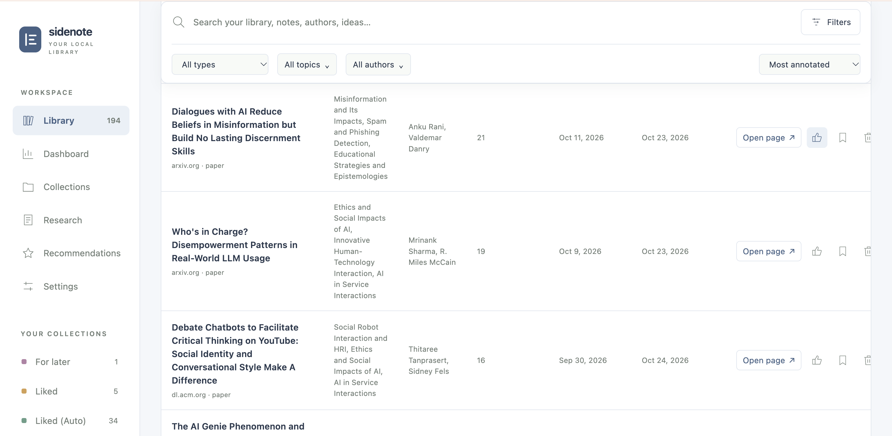
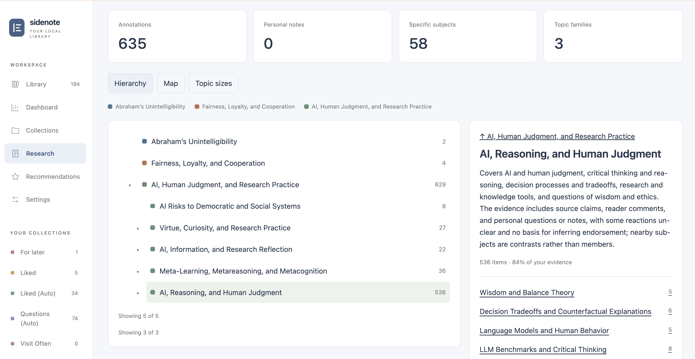
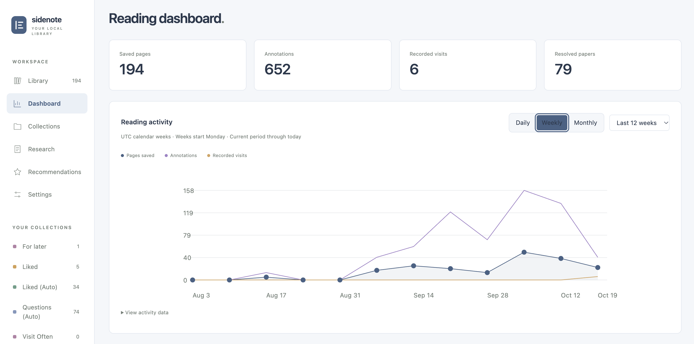
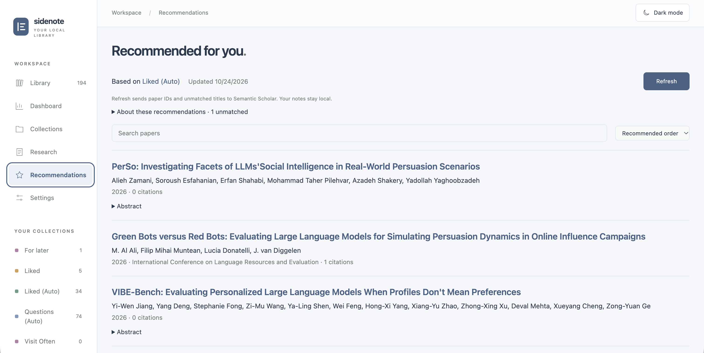
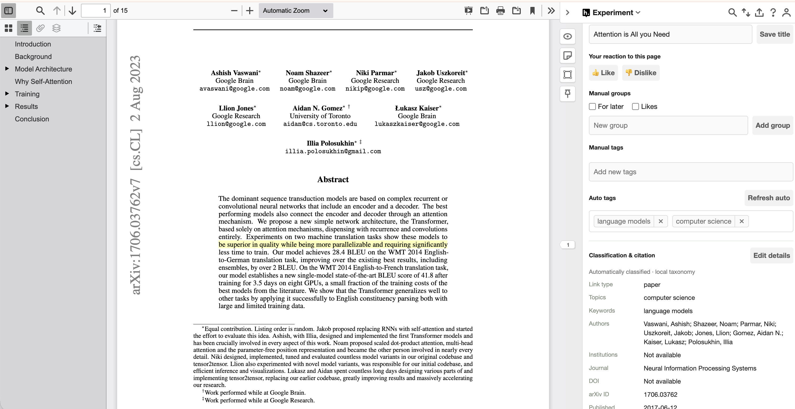
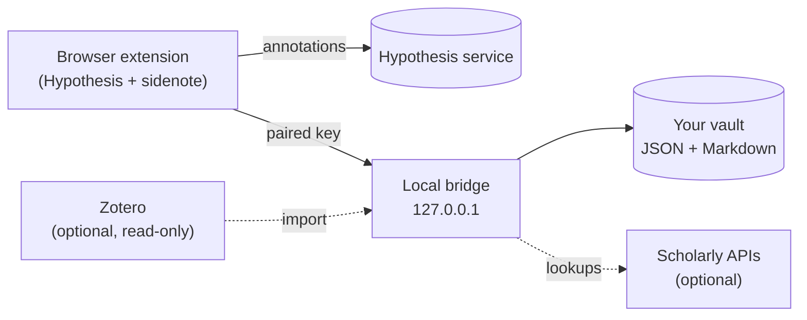

<div align="center">


# sidenote

**A local-first research library built on the Hypothesis web annotator.**

Annotate papers in your browser as usual. sidenote turns those highlights and comments
into a searchable library, topic map, and Markdown notes vault that stays on your machine.

[](https://github.com/YXGuan/sidenote/actions/workflows/checks.yml)
[](LICENSE)
[](docs/SETUP.md#prerequisites)
[](docs/SETUP.md#prerequisites)
[](#quick-start)

[Features](#features) · [Quick start](#quick-start) · [How it works](#how-it-works) · [Privacy](#privacy) · [Docs](#documentation) · [Roadmap](#roadmap)

<br>



</div>

> [!NOTE]
> sidenote is an independent, early-stage project. It runs as a local backend plus an
> unpacked Chrome extension, so expect some setup. See [Quick start](#quick-start).

## Why sidenote?

I've been reading a *lot* of research papers. Where I read, where I take notes, and
where I ask questions were scattered across different apps. Recalling a paper or a concept
when I needed it took too much manual housekeeping.

[Hypothesis](https://hypothes.is/) has the best in-browser annotation I've used, so
sidenote keeps it and adds what was missing:

- **Analytics:** better search, topic analysis, and paper recommendations.
- **Automation:** metadata, tags, and collections that maintain themselves.
- **Ownership:** your library and notes live in a local vault you control.

## Features

- **Library:** search across papers, notes, authors, and ideas, with filters,
  editable metadata, and collections.
- **Topic analysis:** offline topic labels from an [editable taxonomy](research-partner/research_notes/taxonomy.json),
  plus automatic *Liked*, *Questions*, and *Visit often* collections.
- **Research workspace:** library retrieval, a cited Wiki, a knowledge graph, and an
  optional Kura atlas and model-assisted tools.
- **[Paper recommendations](docs/RECOMMENDATIONS.md):** Semantic Scholar suggestions seeded
  from your *Liked (Auto)* collection, cached locally until you choose to refresh.
- **Citation metadata:** authors, venue, DOI, and arXiv ID are extracted automatically,
  like Zotero or Mendeley.
- **[Zotero import](docs/ZOTERO.md):** bring in references and notes from Zotero desktop
  or your online library (read-only).

<table>
  <tr>
    <td width="50%" valign="top">
      <b>Topic analysis</b><br>
      <sub>Browse your reading as a topic hierarchy, map, or size chart.</sub><br><br>
      
    </td>
    <td width="50%" valign="top">
      <b>Reading dashboard</b><br>
      <sub>Track saved pages, annotations, visits, and resolved papers over time.</sub><br><br>
      
    </td>
  </tr>
  <tr>
    <td width="50%" valign="top">
      <b>Recommendations</b><br>
      <sub>Related papers from Semantic Scholar, based on what you liked.</sub><br><br>
      
    </td>
    <td width="50%" valign="top">
      <b>Enhanced Hypothesis sidebar</b><br>
      <sub>Reactions, groups, auto tags, and citation details next to the paper.</sub><br><br>
      
    </td>
  </tr>
</table>

## Quick start

**Requirements:** Python 3.10+ with pip, Node.js 22+, Git, Make, rsync, Chrome (or another
Chromium browser), and a [Hypothesis](https://hypothes.is/) username.

```sh
git clone https://github.com/YXGuan/sidenote.git
cd sidenote
./setup --check                                         # read-only prerequisite check
./setup --user YOUR_HYPOTHESIS_USERNAME --install-service
```

`--install-service` sets up a persistent background service on macOS. On other Unix systems,
leave it out and run the printed bridge command in a separate terminal. Native Windows is
not yet documented. Setup installs local dependencies, creates or reuses your vault, and
builds the extension.

Then connect the browser:

1. Open `chrome://extensions`, turn on **Developer mode**, click **Load unpacked**, and
   select `hypothesis/browser-extension/build/`.
2. Run `./research-partner/notes pair` to get a pairing key.
3. In the extension's **Options → Local research**, enter the key and open the local library.

> [!TIP]
> Prefer to have a coding agent do it? [The setup guide](docs/SETUP.md#clone-then-ask-your-agent)
> has a copy-paste prompt for Claude Code or Codex. It also covers verification, optional
> imports, and troubleshooting.

> [!WARNING]
> Keep your pairing key private. It authorizes access to your local library.

## How it works

sidenote is not a separate reader. It extends the official Hypothesis client and browser
extension through [tracked patches](hypothesis/patches/), so annotating, publishing, and
sharing still work the way they do in Hypothesis. Everything sidenote adds goes through an
authenticated bridge on `127.0.0.1` into a vault you own.



See [architecture](research-partner/docs/ARCHITECTURE.md) for integration points,
storage, and recovery snapshots.

## Privacy

The baseline setup needs no API key and no LLM account.

| What | Where it goes |
| --- | --- |
| Metadata, tags, reactions, collections, Markdown notes | Your local vault only |
| Topic analysis and automatic collections | Computed offline on your machine |
| Annotations you publish | Hypothesis, through its normal workflow |
| Recommendation refresh (only when you ask) | Paper IDs and unmatched titles → Semantic Scholar |
| Scholarly enrichment (optional) | Bibliographic lookups → Semantic Scholar, OpenAlex, Crossref |
| Zotero import (optional) | Read-only requests to Zotero desktop or `api.zotero.org` |

Model-assisted features are opt-in and need explicit authorization. See
[security and data boundaries](SECURITY.md) for details.

## Documentation

| Guide | Covers |
| --- | --- |
| [Setup](docs/SETUP.md) | Install, agent prompt, verification, imports, troubleshooting |
| [Library features](hypothesis/DASHBOARD.md) | Library, dashboard, and collections |
| [Research workspace](research-partner/docs/RESEARCH-WORKSPACE.md) | Retrieval, Wiki, knowledge graph, Kura atlas |
| [Recommendations](docs/RECOMMENDATIONS.md) | How seeds are chosen and what is sent |
| [Zotero](docs/ZOTERO.md) | Desktop and online library import |
| [Classification](research-partner/docs/CLASSIFICATION.md) | Topic labeling and the editable taxonomy |
| [Architecture](research-partner/docs/ARCHITECTURE.md) | Integration points, storage, and recovery |
| [Development](docs/DEVELOPMENT.md) | Builds, checks, and the patch workflow |
| [Native extension](hypothesis/README.md) · [Backend](research-partner/README.md) | Subsystem references |
| [Feature map](docs/FEATURE-MAP.md) | How sidenote compares with other research tools |

## Roadmap

- [x] Local library, topic analysis, and reading dashboard
- [x] Semantic Scholar recommendations
- [x] Zotero import (desktop and online)
- [ ] Easier installation
- [ ] Broader support for everyday reading beyond research papers
- [ ] More ways to revisit saved ideas

## Contributing

Contributions are welcome. Start with [CONTRIBUTING.md](CONTRIBUTING.md) and the
[development guide](docs/DEVELOPMENT.md). If you work with a coding agent, its
instructions are in [AGENTS.md](AGENTS.md). Report security issues privately as described
in [SECURITY.md](SECURITY.md).

## Acknowledgements

Built on [Hypothesis](https://github.com/hypothesis). Other foundations include
[Kura](https://github.com/jxnl/kura),
[Karpathy's LLM Wiki pattern](https://gist.github.com/karpathy/442a6bf555914893e9891c11519de94f),
[Hallmark](https://github.com/nutlope/hallmark), NLTK/VADER, rank-bm25, NetworkX, and
Cytoscape.js. Optional integrations use Semantic Scholar, OpenAlex, Crossref, Zotero,
and Zotero's translation server. Full sources and notices are in [THIRD_PARTY_NOTICES.md](THIRD_PARTY_NOTICES.md).

## License

sidenote is released under the [BSD-2-Clause](LICENSE) license and retains the
[original project notice](third_party/licenses/productivity.txt). Borrowed code and assets
keep their own licenses.
