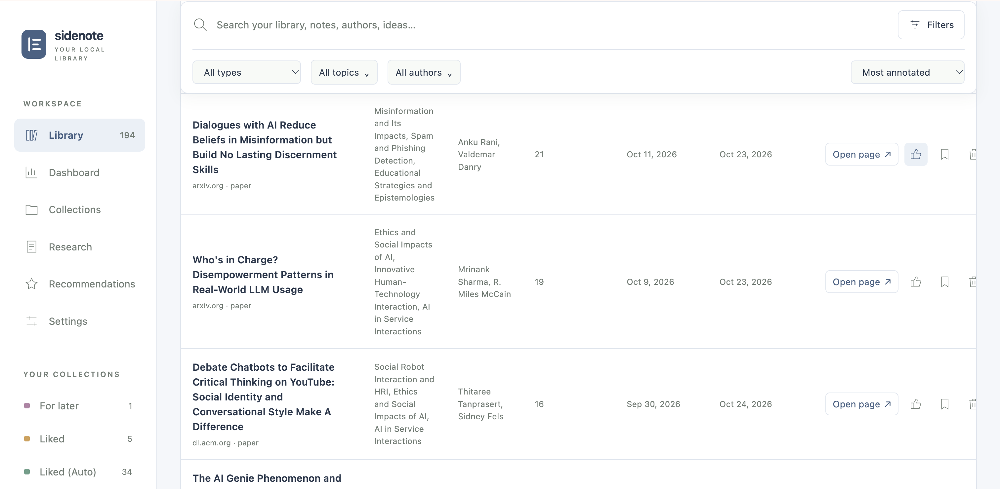
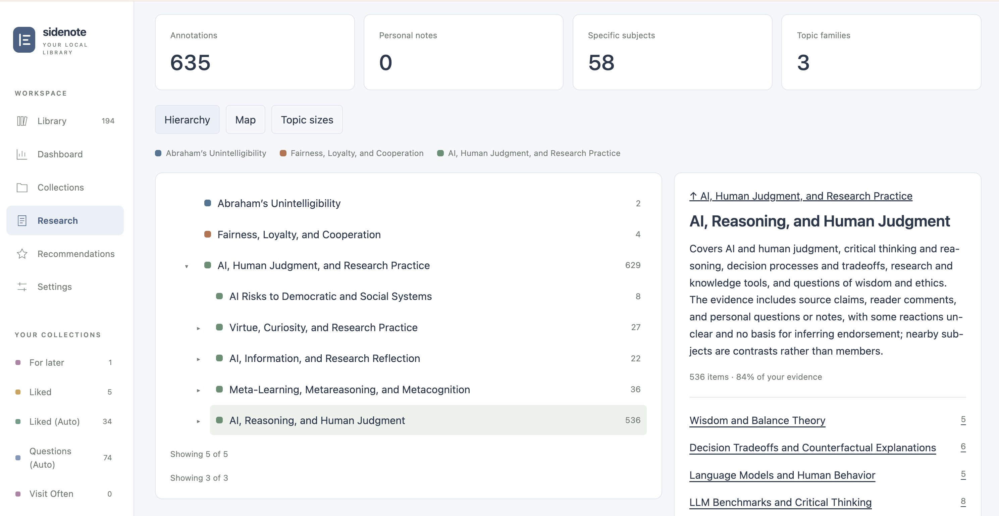
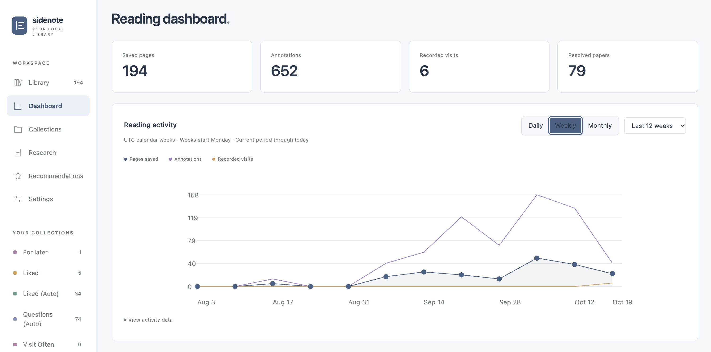
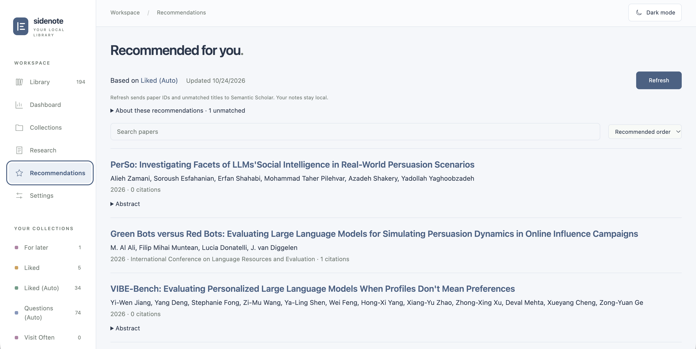
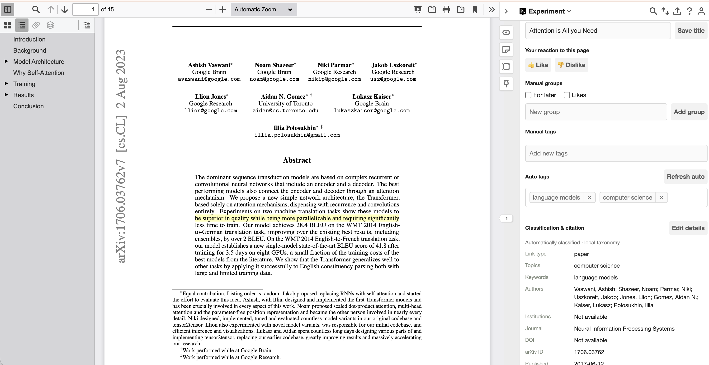

# sidenote


# How it got started:

I have found myself reading a LOT more research papers nowadays

where I read, where I take notes, where I ask questions are all very scattered

it has become very hard to organize knowledge and learning ( such as recalling the name of the paper or a conceptI read when I need them)

there's too much manual housekeeping, fragmented apps/ecosystem

Then I found out about [hypothes.is](https://hypothes.is/), where I immediately fell in love with their browser plug in, I think they have the BEST in-browser annotation.

However it's missing some features and we could make it even better:

1. analytics: better search, recommendation
2. automation: it's still too much manual housekeeping
3. ...

so I vibe coded this repo



Topical analysis



Dashboard



Recommendations ( using S2 rec api)



Some changes to the sidebar in Hypothesis



(auto extract biblographic meta data just like Zotero or Mendeley)

Note:

all the extra features stay locally

AI Generated Notes below:

**sidenote** extends the Hypothesis browser extension with a local research
library and Markdown notes vault. This independent, early-stage project requires
a local backend and an unpacked Chrome extension.

## Setup

Requires Python 3.10+ with pip, Node.js 22+, Git, Make, rsync, and Chrome.

```sh
git clone https://github.com/YXGuan/sidenote.git
cd sidenote
./setup --check
./setup --user YOUR_HYPOTHESIS_USERNAME --install-service
```

On other Unix systems, omit `--install-service` and run the printed foreground
bridge command separately. Setup installs local dependencies, initializes or
reuses your vault, and builds the extension.

In `chrome://extensions`, enable **Developer mode → Load unpacked** and select
`hypothesis/browser-extension/build/`. Pair in **Extension options → Local
research** using the key from `./research-partner/notes pair`, then open the local
library. Keep the pairing key private.

See [the setup guide](docs/SETUP.md) for verification, optional imports, and
troubleshooting. For agent-assisted installation, use the prompt in that guide;
agent instructions live in [AGENTS.md](AGENTS.md).

## Features

- **Library:** search, filters, editable metadata, dashboards, and collections.
- **Local analysis:** topic labels, automatic liked/question collections, and
  saved-page visit tracking.
- **Research:** library retrieval, a cited Wiki, knowledge graph, and optional
  Kura atlas and model-assisted tools.
- **[Paper recommendations](docs/RECOMMENDATIONS.md):** Semantic Scholar suggestions
  seeded from Liked (Auto), cached locally until you request a refresh.

Baseline setup needs no API key or LLM account. Local metadata and collections
stay in your vault; Hypothesis publishing/sync, scholarly services, and model
features are separate optional workflows. Recommendation refresh sends paper
identifiers and unmatched titles to Semantic Scholar. See
[security and data boundaries](SECURITY.md).

Future work includes easier installation, broader support for everyday reading,
and more ways to revisit saved ideas.

## Documentation

- [Library features](hypothesis/DASHBOARD.md) and
  [Research workspace](research-partner/docs/RESEARCH-WORKSPACE.md)
- [Classification](research-partner/docs/CLASSIFICATION.md) and
  [editable taxonomy](research-partner/research_notes/taxonomy.json)
- [Development and checks](docs/DEVELOPMENT.md),
  [native extension](hypothesis/README.md), and [backend](research-partner/README.md)

## Borrowed foundations and acknowledgements

Built on [Hypothesis](https://github.com/hypothesis). Other foundations
include Kura, Karpathy's LLM Wiki pattern, Hallmark, NLTK/VADER, rank-bm25,
NetworkX, and Cytoscape.js. Optional integrations use Semantic Scholar, OpenAlex,
Crossref, and Zotero's translation server. Full sources and notices are in
[THIRD_PARTY_NOTICES.md](THIRD_PARTY_NOTICES.md).

sidenote uses [BSD-2-Clause](LICENSE) and retains the
[original project notice](third_party/licenses/productivity.txt). Borrowed code
and assets retain their own licenses. See [contributing](CONTRIBUTING.md).
