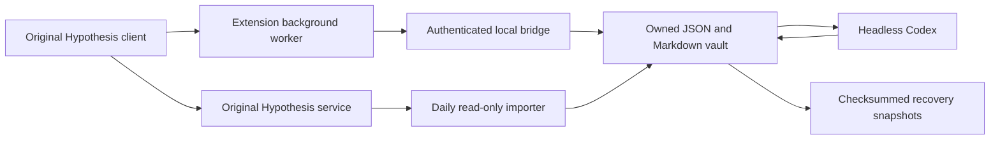

# Architecture

The browser interface is implemented directly in the original repositories at
`hypothesis/client/` and `hypothesis/browser-extension/`. Their layouts, CSS,
assets, annotation anchoring, groups, editor, and publication flow remain
Hypothesis. The parent workspace records native changes as reproducible patches.
See [the build instructions](../../hypothesis/README.md).

## Native integration points

- `AnnotationActionBar.tsx` includes annotation-specific reactions and sentiment controls using
  the same Hypothesis IconButton/Button components. Reactions and inferred stance
  are keyed by annotation ID; page controls live in Page Notes.
- `PageResearch.tsx` adds URL-level title, citation metadata, separate Manual and
  Auto tags, automatic type/topic/subtopic groups, manual collections, and
  Like/Love/Bad/Hate page ratings inside the original Page Notes tab. Annotation
  drafts and their original TagEditor are independent.
- `AnnotationHeader.tsx` displays the local title in its existing document label.
- `AnnotationsService.save` mirrors successfully saved owner annotations locally
  without making the original save depend on the local service.
- `FrameSyncService` captures the active document's metadata through Hypothesis's
  existing guest RPC connection; it does not collect arbitrary browsing history.
- `HTMLMetadata` retains its existing citation priorities and fills missing
  fields from observed Schema.org JSON-LD authors, affiliations, and identifiers.
- The original extension worker mediates authenticated local requests, keeping
  the bridge key out of the content page and client settings.
- A profile content script adds an inline pencil to the original document-title
  row. It saves local titles and reapplies them on reload, preserving the rest
  of the existing profile markup. It does not change the hosted server record.
- Local configuration uses the original extension's options page. There is no
  extra popup, standalone reader, or alternate annotation UI.

## Source and storage

The two actual Git checkouts retain their upstream remotes and licenses. The
extension links its `hypothesis` package to `portal:../client`. Pinned revisions
and exported patches allow rebuilding the original repositories with these
additions. No upstream source is reimplemented as a separate interface.

Hypothesis's [documented storage architecture](https://h.readthedocs.io/en/latest/arch/adr-001/)
uses PostgreSQL for persistent annotations and a rebuildable Elasticsearch index.
The [browser extension](https://github.com/hypothesis/browser-extension) wraps its
[annotation client](https://github.com/hypothesis/client). A local extension clone
alone does not relocate the user's stored annotations.

The local vault retains original API JSON, citation provenance, personal titles,
reactions, curated tags, derived proposals, and Markdown notes. Hypothesis remains
responsible for annotation sharing and hosted bodies; local fields remain
independent. Rich citation information captured before the hosted API flattens
it is preserved locally. Automatic page tags and classification are cached in
local analysis records, with per-page dismissed tags held in overrides. Annotation
drafts retain the original Hypothesis publish workflow.

## Import and recovery

Full scans use `created` ascending, page size 200, and search_after. IDs are
validated/deduplicated, the fetched count must equal the initial total, and the
remote total is checked again. A tied timestamp spanning a page boundary or a
changing count causes visible failure before the success marker advances.
Original records missing in later scans remain retained because deletion,
permission changes, search lag, and public-only scans are ambiguous.

Individual writes are atomic and fsynced. The vault lock serializes source
imports and local writes. Multi-file updates are not transactional: a crash can
leave newer raw files without a new success marker, while prior recovery
snapshots remain intact. Remote changes during a scan can be reconciled on the
next full scan; the API supplies no transactional snapshot token.

Every successful import writes a self-contained checksummed snapshot of retained
records and local edits. Restore validates checksum and IDs and requires an empty
folder. It excludes credentials and does not republish to Hypothesis. PDF URNs
and file source identifiers are preserved without reading local files. DOI/URL
alias merging and source page/PDF byte archiving remain future work.

## Local bridge and model boundary

The bridge binds only to 127.0.0.1, checks Host and Origin, and requires a local
bearer key. The worker accepts local research messages only from its own pages
or the permitted Hypothesis profile content script. The Hypothesis developer
token is persisted in the ignored backend `.env` file with mode 600. The local extension has a
distinct public key/ID and the name sidenote, allowing it to coexist with
the official extension. Its original Log in control obtains the configured
account token through the authenticated `/api/account` route and holds it only in
sidebar memory. The worker rejects account requests from profile content scripts
and other extensions. The auth service only supplies this token for the exact
Hypothesis API host. Chrome stores the bridge key and a login preference, never
the account token. Local logout clears the preference without revoking the
backend token; the official extension keeps its original OAuth flow. Neither
credential belongs in patches or build output.

All LLM processing uses headless codex exec with structured output, ephemeral
execution, a read-only sandbox, disabled shell/browser/app/plugin tools, and an
isolated temporary working directory. The Hypothesis token is removed from its
environment. Draft suggestions and saved-note analysis validate known annotation
IDs, reader-comment evidence, and confidence. Highlights alone and confidence
below 70% produce unknown. Explicit reactions are never overwritten.

## Local dashboard and page/annotation scope

LocalLibraryView runs on the original notebook route with `local-library=1`. It
uses the same client, Card/Input/Button components, and extension worker. The
authenticated library endpoint returns compact URL records; expanding a page
loads its stored metadata and annotations. Page edits are held in `overrides/`,
auto tags and classification in `analysis/`, and per-annotation state in
`annotation_state/`. Manual page tags, group membership, ratings, and dismissed
auto tags live in `overrides/`; the persistent group catalog lives in
`collections/manual.json`. For later and Likes always exist. Like/Love add the
page to Likes; Bad/Hate/clearing a rating remove it. Changing Likes membership
updates a positive rating consistently. Recovery snapshots include these
collections while remaining compatible with older snapshots.

Page-tag analysis provides saved highlights/comments as page context while
requesting no annotation sentiments. Organization assigns one link type, multiple
topics, and subtopics linked to their parent topics. Each batch validates exact
document IDs and the hierarchy before saving, and checks the source fingerprint
again so a concurrent edit is not overwritten. Failures preserve earlier data.
Manual fields and annotation reactions are never generated by this classifier.

The dashboard defaults to a List styled like the hosted Hypothesis profile,
with white source rows, month headings, grey domains, dark titles, and a right
summary column. Overview charts, a compact Table, and a grouped Board use the
same records. All support text/field search, filters, and date/rating sorts.
Charts count distinct pages per label and report metadata coverage. The saved
view, sort, and board dimension are browser-local preferences.

Imports, metadata captures, and mirrored saves categorize pages automatically
with offline local rules by default. They use no model package or service. A
failed classifier cannot fail a durable annotation backup. Local results carry
`local-rules` provenance, and ambiguous evidence remains unknown.

Optional Codex categorization defaults to `gpt-6-luna`, low reasoning effort, and
the compatible project-local CLI, without changing the user's global CLI. The
adapter prefers `NOTES_CODEX_BIN`, then `.local-tools/`, then PATH. Model/provider
changes invalidate cached classifications. CLI transcripts are never returned to
the UI; model compatibility failures produce a fixed diagnostic and stop the
remaining batches instead of repeating an unsupported call.

Only a Codex bulk job shows a data-transfer confirmation. The bridge requires
boolean approval for that transfer, or the explicit ongoing preference saved by
`notes categorization --provider codex --allow-private-context`. Choosing local
revokes that preference. Local jobs need no transfer approval. The automatic
backend preference covers imports/captures, while the existing extension setting
also controls sidebar refresh requests. Manual Refresh auto remains available.

Annotation analysis sends only the selected
annotation and verifies that it did not change before saving. Explicit reactions
remain independent. All LLM operations use the same headless Codex adapter; the
local rule classifier performs no LLM calls. See the
[classifier assessment](CLASSIFICATION.md) for the local NLP comparison.

## Persistent local service

A separate per-user macOS LaunchAgent runs `notes serve`, with RunAtLoad and
KeepAlive enabled. It is independent of the daily annotation export job and of
temporary terminal/Codex sessions. Its label ends in `.bridge` and is derived
from the vault path. Installation refuses an unmanaged listener on port 8765,
and replacement/uninstallation targets only that bridge label. The listener
remains authenticated loopback-only. Tokens stay in `.env`; the agent contains
only executable paths and nonsecret model/PATH settings. Logs use umask 077.

`notes service --install`, `--status`, and `--uninstall` manage this process.
`notes doctor` reports managed-service health along with the existing vault and
sync diagnostics.

## Research workspace

The existing library now has a Research tab with Ask + web, natural-language
retrieval, wiki, and graph views. Authenticated `/api/research` jobs run on the
backend and are polled through the extension worker; only extension pages may
invoke these actions. Local ranking reuses rank-bm25/NLTK, graph construction
uses NetworkX, and the native client renders it with Cytoscape.js.

Wiki state and immutable prior generations live in `knowledge/`, separate from
raw annotations, manual overrides, and personal notes. Markdown in `wiki/` is a
regenerable export. Recovery snapshots include canonical wiki records. Model
synthesis validates named evidence and exact source quotes, then verifies the
source fingerprint and wiki generation again under the vault lock before commit.
Ask uses relevant saved excerpts and current wiki claims; stale synthesis is
excluded. Only explicit answering calls may enable live web search.
See [Research workspace](RESEARCH-WORKSPACE.md) for data boundaries and limits.
